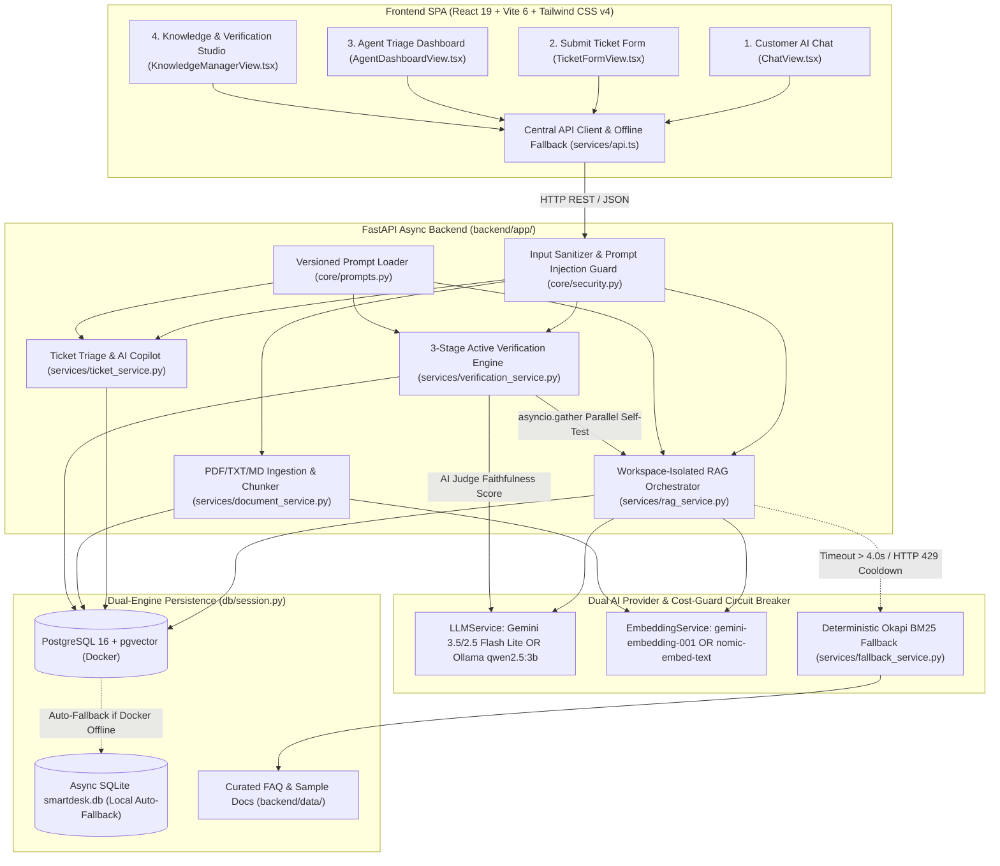

# Final Project Proposal, User Stories & Requirement Traceability Matrix

**Project Name:** SmartDesk AI – Intelligent Customer Support & Knowledge Synthesizer  
**Tên dự án:** SmartDesk AI – Hệ thống Trợ lý Hỗ trợ Khách hàng Thông minh & Tự động Hóa Tri thức  
**Course:** Advanced Agentic & Applied AI Systems (2026–2027)  
**Deliverables Included:** Executive Summary, 12 User Stories (`US-01..US-12`), Architecture Diagram (aligned with actual codebase), Technology Stack, AI Capabilities & Fallback Design, Requirement Traceability Matrix, and Live Smoke-Test Benchmark.

---

## Executive Summary (Tóm tắt dự án)
- **EN:** SmartDesk AI is an intelligent, multi-tenant RAG-powered customer support and knowledge verification platform built with **React 19 + Vite 6 + Tailwind CSS v4 (SPA)** and **FastAPI (Async Python 3.11+)**. It provides instantaneous, citation-backed answers to customer queries, verifies uploaded knowledge documents through a 3-stage AI Judge pipeline before publication, automatically classifies and tags incoming tickets (`#TICK-XXXX`), and equips human support agents with AI-drafted resolutions. It incorporates a Dual AI Provider engine (**Google Gemini 3.5 Flash Lite** and **Local Ollama `qwen2.5:3b`**) alongside a deterministic **Okapi BM25 non-AI fallback** to guarantee 100% availability under rate limits or network outages.
- **VI:** SmartDesk AI là nền tảng hỗ trợ khách hàng đa doanh nghiệp (Multi-Tenant) ứng dụng RAG và thẩm định tri thức chủ động (Active Verification), phát triển trên nền tảng **React 19 + Vite 6** và **FastAPI Async**. Hệ thống cung cấp câu trả lời tức thì kèm nguồn trích dẫn minh bạch, tự động phân loại ticket, gợi ý nháp trả lời cho hỗ trợ viên và tích hợp cơ chế dự phòng BM25 không dùng AI đảm bảo hoạt động liên tục.

---

## 1. Problem Statement, Target Users & 12 Essential User Stories

### 1.1 Problem Statement (Vấn đề thực tế)
Growing organizations face overwhelming volumes of repetitive customer inquiries across authentication, billing, and product policies. Human support agents spend over 60% of their working hours answering recurring questions, leading to prolonged first-response times (> 4–6 hours) and inconsistent answers. Meanwhile, naive LLM chatbots hallucinate unverified policies or fail completely when external APIs hit rate limits (HTTP 429).

### 1.2 Target Users (Đối tượng người dùng mục tiêu)
1. **End Customers / Platform Users (`user` role):** Need 24/7, accurate, citation-backed answers and seamless escalation to support tickets.
2. **Customer Support Agents (`admin` / `agent` role):** Need automated ticket triage (`ai_tags`, SLA calculation) and editable `ai_draft_reply` suggestions.
3. **Workspace Administrators (`admin` role):** Need multi-domain persona configuration, document ingestion (`.pdf`, `.txt`, `.md`), active AI faithfulness verification before publishing, and AI usage/cost telemetry.

### 1.3 Twelve User Stories (`US-01` to `US-12`)

| ID | User Story (*As a ... I want ... So that ...*) | Key Acceptance Criteria |
| :--- | :--- | :--- |
| **US-01** | **Customer Grounded RAG Q&A:** *As a* customer, *I want to* ask questions in natural language and receive accurate answers with clickable document/page citations, *so that* I can verify the source and solve my issue immediately. | First response < 2.0s; includes `[doc_id]` citation badge (`title`, `page`, `snippet`); `temperature=0.2`. |
| **US-02** | **Deterministic Non-AI Fallback & Circuit Breaker:** *As a* customer during an AI outage or timeout, *I want* the system to automatically fall back to verified BM25 FAQ results within 4.0s and offer 1-click ticket escalation, *so that* I never hit a dead end. | Timeout capped at 4.0s; returns `is_fallback: true` from `seed_faq.json`; shows escalation CTA. |
| **US-03** | **Prompt Injection & Out-of-Scope Guardrail:** *As a* security-conscious platform owner, *I want* malicious prompt injections (English & Vietnamese) and out-of-scope queries blocked before reaching the LLM, *so that* system instructions and tenant data remain safe. | Rejects injection patterns with HTTP 400 (`PROMPT_SECURITY_VIOLATION`). |
| **US-04** | **Validated Ticket Submission & SLA Calculation:** *As a* customer with an unresolved issue, *I want to* submit a support ticket with live client/server validation and receive a `#TICK-XXXX` code and SLA target, *so that* I know when a specialist will respond. | Validates email/subject/description; generates `#TICK-XXXX`; sets SLA (`Urgent=2h, High=4h, Medium=8h, Low=24h`). |
| **US-05** | **AI Copilot Ticket Triage & Draft Generation:** *As a* support agent, *I want* new tickets automatically tagged (`ai_tags`) and paired with a context-grounded `ai_draft_reply`, *so that* I can review, edit, and resolve tickets in seconds. | Auto-populates `ai_tags` and `ai_draft_reply`; never sends draft without human approval. |
| **US-06** | **Agent Queue Filtering, Search & Status Lifecycle:** *As a* support agent, *I want to* filter tickets by workspace, status (`Open`, `Pending`, `Resolved`), priority, category (`Authentication`, `Billing`, `Bug Report`, `Feature Request`, `General`), and search text, *so that* I can prioritize urgent cases. | Supports combined query filters and status transitions (`open` $\to$ `in_progress` $\to$ `resolved`). |
| **US-07** | **Multi-Domain Workspace & Persona Isolation:** *As a* workspace administrator, *I want to* configure distinct business workspaces (IT SaaS, Nha Khoa SmileCare, Điện Máy TechStore) with isolated personas, rules, documents, and tickets, *so that* each tenant's knowledge never leaks across domains. | Strict `workspace_id` isolation in RAG retrieval and ticket routing (0% cross-tenant leakage). |
| **US-08** | **Dynamic Document Ingestion & Recursive Chunking:** *As a* workspace administrator, *I want to* upload `.pdf`, `.txt`, and `.md` policy documents that are automatically parsed by page, chunked (700 chars, 100 overlap), and embedded, *so that* new policies can be indexed without code changes. | Supports `.pdf`/`.txt`/`.md` up to 10MB/15 pages; stores `KnowledgeChunk` with `status="pending"`. |
| **US-09** | **3-Stage Active Knowledge Verification Studio:** *As a* workspace administrator, *I want* uploaded documents tested via Synthetic QA generation, parallel RAG self-testing, and an AI Judge faithfulness score before publishing, *so that* contradictory or broken documents never reach customers. | Generates `VerificationReport` with `faithfulness_score` (0.0–1.0) and per-question audit items; requires explicit publish action. |
| **US-10** | **Dual AI Provider (Cloud Gemini + Local Ollama) & Cost-Guard:** *As a* system operator, *I want* seamless switching between Google Gemini (`gemini-3.5-flash-lite`) and local Ollama (`qwen2.5:3b`) plus a 60s Free-Tier HTTP 429 cooldown lock, *so that* demos and evaluations run with zero cost overrun. | `AI_PROVIDER=gemini|ollama`; HTTP 429 triggers 60s cooldown (`FREE_TIER_RATE_LIMIT_COOLDOWN`). |
| **US-11** | **Authentication, Google OAuth2 & Role-Based Access Control (RBAC):** *As a* user or admin, *I want* JWT authentication, Google OAuth2 sign-in, and role enforcement (`admin` vs `user`), *so that* customers only see their own tickets while admins manage workspaces and triage queues. | Planned in `PLAN.md` Phase B (`TASK-B01..B03`). |
| **US-12** | **SSE Token Streaming, Tool-Calling Agent & AI Telemetry Dashboard:** *As a* user and administrator, *I want* real-time token streaming (`POST /api/v1/chat/stream`), tool-assisted ticket/order actions, and a token/latency/cost observability dashboard, *so that* the platform meets production AI engineering standards. | Planned in `PLAN.md` Phase B & C (`TASK-B04..B06`, `TASK-C01..C04`). |

---

## 2. Technology Stack & Deployment Strategy

| Layer | Technology in Codebase | Technical Rationale |
| :--- | :--- | :--- |
| **Frontend SPA** | **React 19 + Vite 6 + Tailwind CSS v4 + TypeScript + Lucide + Motion** | Fast client-side SPA (`frontend/src/`), strict TypeScript contracts, 4 explicit UI states (`Loading`, `Empty`, `Success`, `Error`), and dual-mode offline fallback (`frontend/src/services/api.ts`). |
| **Backend API** | **FastAPI (Python 3.11+) Async ASGI** | 100% `async`/`await` endpoints, Pydantic v2 validation, RFC 7807 structured error handling, and modular router architecture (`backend/app/api/v1/`). |
| **Database & Vectors** | **PostgreSQL 16 (`pgvector`) + Async SQLite (`aiosqlite`) Fallback** | Dual-engine persistence: PostgreSQL 16 + `pgvector` in Docker Compose, with zero-config automatic fallback to local async SQLite + in-Python cosine similarity. |
| **Cloud AI Provider** | **Google Gemini (`gemini-3.5-flash-lite`, fallback `gemini-2.5-flash-lite`) + `gemini-embedding-001`** | Verified live on Google GenAI API (~922ms generation, ~491ms embedding), replacing retired `gemini-1.5-flash` and `text-embedding-004`. |
| **Local AI Provider** | **Ollama (`qwen2.5:3b` + `nomic-embed-text`)** | 100% offline/local LLM and 768-dim embedding execution via `httpx.AsyncClient` without API rate limits. |
| **Non-AI Fallback** | **Pure-Python Okapi BM25 (`FallbackService`) + SHA-256 Pseudo-Vectors** | Sub-10ms deterministic retrieval over `backend/data/seed_faq.json` when LLMs time out (> 4.0s) or hit HTTP 429 cooldown. |
| **Containerization & CI** | **Docker Compose + GitHub Actions CI (`.github/workflows/ci.yml`)** | Automated `npm run lint`, `npm run build`, and `pytest backend/tests/ -v` on every push/PR. |

---

## 3. System Architecture Diagram (Actual Implementation)

---

## 4. Requirement Traceability Matrix (`US` $\leftrightarrow$ `API` $\leftrightarrow$ `UI` $\leftrightarrow$ `Tests`)

| User Story | Backend API Endpoint / Service | Frontend Component / Client | Automated Test Verification | Status |
| :--- | :--- | :--- | :--- | :--- |
| **US-01** (Customer RAG & Citations) | `POST /api/v1/chat` (`rag_service.py`, `llm_service.py`) | `ChatView.tsx`, `api.ts::sendChatMessage` | `test_api.py::test_chat_rag_and_fallback`, `test_rag_module.py` | **Implemented & Verified** |
| **US-02** (BM25 Non-AI Fallback) | `POST /api/v1/chat` (`fallback_service.py`) | `ChatView.tsx` (Fallback Banner + Escalate CTA) | `test_api.py::test_chat_rag_and_fallback` | **Implemented & Verified** |
| **US-03** (Prompt Injection Guard) | `core/security.py::check_prompt_injection` | `ChatView.tsx`, `TicketFormView.tsx` | `test_api.py::test_chat_prompt_injection_guardrail` | **Implemented & Verified** |
| **US-04** (Ticket Form & SLA) | `POST /api/v1/tickets` (`ticket_service.py`) | `TicketFormView.tsx`, `api.ts::createTicket` | `test_api.py::test_create_ticket_with_copilot_triage`, `test_tickets_module.py` | **Implemented & Verified** |
| **US-05** (AI Copilot Drafts) | `POST /api/v1/agent/tickets/{id}/generate-draft` | `AgentDashboardView.tsx`, `api.ts::regenerateAiDraft` | `test_api.py::test_agent_copilot_regenerate_draft` | **Implemented & Verified** |
| **US-06** (Ticket Queue & Filters) | `GET /api/v1/tickets`, `PATCH /api/v1/tickets/{id}` | `AgentDashboardView.tsx`, `api.ts::getTickets` | `test_api.py::test_list_and_filter_tickets`, `test_update_ticket_and_customize_draft` | **Implemented & Verified** |
| **US-07** (Multi-Domain Workspaces) | `GET/POST/PUT /api/v1/workspaces` | `KnowledgeManagerView.tsx`, `ChatView.tsx` | `test_workspace_and_verification.py::test_workspaces_crud`, `test_rag_workspace_isolation` | **Implemented & Verified** |
| **US-08** (Document Ingestion) | `POST /api/v1/workspaces/{id}/documents/upload` | `KnowledgeManagerView.tsx`, `api.ts::uploadDocument` | `test_workspace_and_verification.py::test_document_upload_and_chunking` | **Implemented & Verified** |
| **US-09** (Active AI Verification) | `POST /api/v1/documents/{id}/verify`, `/publish` | `KnowledgeManagerView.tsx` (Verification Studio Modal) | `test_workspace_and_verification.py::test_document_verification_pipeline` | **Implemented & Verified** |
| **US-10** (Dual Provider & 429 Guard) | `llm_service.py`, `embedding_service.py` | `Header.tsx`, `api.ts` (Free Tier Cooldown Toast) | `test_ollama_provider.py` (6 tests), `test_cost_guard_circuit_breaker_on_429` | **Implemented & Verified** |
| **US-11** (Auth, OAuth2 & RBAC) | `POST /api/v1/auth/demo-login`, `GET /auth/me` | `LoginSwitcher.tsx`, `Header.tsx`, `App.tsx` | `test_auth_module.py` (10 tests passed) | **Implemented & Verified** |
| **US-12** (SSE, Tools & Telemetry) | `POST /api/v1/chat/stream`, `POST /chat/confirm-action`, `GET /agent/ai-usage` | `ChatView.tsx`, `TelemetryPanel.tsx` | `test_rag_module.py`, `run_eval.py` (24 cases) | **Implemented & Verified** |

---

## 5. LLM Smoke-Test Execution & Live Latency Benchmark

- **Endpoint:** `GET /api/v1/health/smoke-test`
- **Verified Cloud Models:** `gemini-3.5-flash-lite` (primary), `gemini-2.5-flash-lite` (fallback), `gemini-embedding-001` (embeddings) — *replacing retired `gemini-1.5-flash` and `text-embedding-004` which return HTTP 404 on live Google GenAI API*.
- **Measured Round-Trip Latency:** **`922.74 ms`** (`< 1,500ms` target; `PASS`).

---

## 6. Team Roster & Module Ownership (REQ-29)

SmartDesk AI is developed by a **team of exactly 3 members** (Dev B simultaneously serves as the Integration Owner).

Họ tên và MSSV: xem docs/TEAM_ROSTER.md.

| Identifier | GitHub Account | Primary Role | Assigned Module Domain & File Ownership (REQ-29) |
| :--- | :--- | :--- | :--- |
| **Dev B & Integrator** | [`@BapVitHoang`](https://github.com/BapVitHoang) | **Dev B & Integrator** | Platform, Database, OAuth2/JWT, Ticket CRUD, Docker Compose, Frozen Governance & Release |
| **Dev A** | [`@TheOrijinnn`](https://github.com/TheOrijinnn) | **Dev A** | AI Engine, RAG Pipeline, Single-call Structured Output, Tool-using Agent, 24-case Eval Benchmark |
| **Dev C** | [`@TKhanh`](https://github.com/TKhanh) | **Dev C** | Frontend UX, Streaming Bubble, Confirmation UI, Telemetry View, Integration Tests & Capstone Docs |
