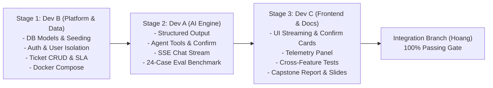

# SmartDesk AI — Team Git Workflow & Integration Protocol

> **Version:** 1.0.0  
> **Status:** FROZEN GOVERNANCE SPECIFICATION  
> **Target Integration Branch:** `Hoang`  
> **Release Target:** The repository default branch on GitHub is `master`. The final release submission requires a reviewed pull request from `Hoang` into `master`.  
> **Governing Documents:** [`AGENTS.md`](../../AGENTS.md), [`docs/ARCHITECTURE.md`](../ARCHITECTURE.md), [`docs/plan/WORKSTREAMS.md`](./WORKSTREAMS.md)

---

## 1. Branch Naming & Module Isolation

To prevent collisions and enable clean Git commit attribution as required by **REQ-29** and **CRIT-06**, every developer works exclusively on a designated feature branch:

| Developer | Role / Workstream | Feature Branch Name | Base Branch |
| :--- | :--- | :--- | :--- |
| **Dev A** | AI Engine & Evaluation | `feature/a-ai-engine` | `Hoang` |
| **Dev B (Hoang)** | Platform, Data & Security (+ Integrator Hat) | `feature/b-platform` | `Hoang` |
| **Dev C** | Frontend UX, QA & Docs | `feature/c-frontend-docs` | `Hoang` |

### 1.1 Branch Creation Commands
When starting work, each developer runs:
```powershell
# Fetch latest remote references
git fetch origin

# Create and checkout your isolated feature branch from origin/Hoang
git checkout -b feature/<your-branch-name> origin/Hoang
```

---

## 2. Daily Rebase Protocol

Because developers work in parallel, staying in sync with the integration branch is mandatory to avoid late integration headaches.

### 2.1 Morning / Start of Day Rebase
Before writing any code each day, rebase your feature branch onto the latest `origin/Hoang`:
```powershell
# 1. Ensure your local changes are committed
git status

# 2. Fetch latest changes from remote
git fetch origin

# 3. Rebase your feature branch on top of origin/Hoang
git rebase origin/Hoang

# 4. Verify your environment is still healthy
powershell -ExecutionPolicy Bypass -File scripts/verify_setup.ps1
```

> [!IMPORTANT]
> **Never Merge Upstream into Your Feature Branch with `git merge`:** Always use `git rebase origin/Hoang` to maintain a clean, linear history. Never use `git push --force` on shared branches. On your personal feature branch, use `git push --force-with-lease origin feature/<your-branch-name>`.

---

## 3. Pre-Commit Verification Gate

Before staging and committing changes, every developer MUST run the automated checks locally. If any check fails, do NOT commit.

### 3.1 Verification Checklist
1. **Ownership Check:**  
   Confirm you haven't touched any files outside your assigned domain:
   ```powershell
   # Replace devA with devB or devC as appropriate
   python scripts/check_ownership.py --owner devA
   ```
2. **Backend Unit & Module Tests:**  
   Run your module's tests and ensure 0 failures:
   ```powershell
   # For Dev A:
   python -m pytest backend/tests/test_rag_module.py backend/tests/test_ollama_provider.py backend/tests/ai/ -v

   # For Dev B:
   python -m pytest backend/tests/test_tickets_module.py backend/tests/test_auth_module.py backend/tests/test_workspace_and_verification.py backend/tests/platform/ -v

   # For Dev C:
   python -m pytest backend/tests/test_api.py backend/tests/common/ -v
   ```
3. **Frontend Type Safety & Linting (Dev C):**  
   ```powershell
   npm run lint --prefix frontend
   npm run build --prefix frontend
   ```
4. **Universal System Health Gate:**  
   ```powershell
   powershell -ExecutionPolicy Bypass -File scripts/verify_setup.ps1
   ```

### 3.2 Commit Message Standard
All commit messages must follow **Conventional Commits**:
- `feat(ai): implement single-call ticket triage structured output (TASK-08)`
- `feat(platform): add oauth2 jwt authentication and rbac dependencies (TASK-12)`
- `feat(ui): implement live token-by-token streaming bubble (TASK-11)`
- `test(ai): add 24-case benchmark runner and deterministic eval (TASK-15)`
- `docs(proposal): add 12 user stories and requirement traceability matrix (TASK-17)`

---

## 4. Pull Request & Merge Sequence

To guarantee zero merge conflicts during final integration, PRs are merged into `Hoang` in a strict **3-stage pipeline**:



### 4.1 Rationale for the Merge Order
1. **Dev B merges FIRST:** Dev B establishes the database tables (`User`, `AIUsageLog`, `pgvector` columns) and authentication endpoints (`/auth/oauth2/login`, `/auth/token`). Dev A and Dev C both depend on these data schemas and auth tokens.
2. **Dev A merges SECOND:** Dev A integrates AI structured outputs (`ticket_copilot_service.py`), agent tools, and streaming endpoints (`/chat/stream`). These backend endpoints are required by Dev C for live UI testing.
3. **Dev C merges THIRD:** Dev C wires the complete user interface to the live backend endpoints, runs cross-feature end-to-end tests (`backend/tests/common/`), and compiles the final capstone documentation pack (`REPORT.md`, `PRESENTATION_AND_DEMO.md`).

### 4.2 Peer Review & Cross-Approval Protocol
Every PR requires formal review and approval from at least one other team member before merging into `Hoang`.

- **Default Peer Review Pairs:**
  - **Dev A's PRs** are reviewed by **Dev B (Hoang)**.
  - **Dev C's PRs** are reviewed by **Dev A**.
  - **Dev B's PRs** are reviewed by **Dev C**.

- **Reviewer Mandatory Checklist:**
  - [ ] **Ownership boundary passes:** Author modified only files within their assigned lane (`python scripts/check_ownership.py`).
  - [ ] **Automated tests pass:** Unit tests and linter exit cleanly with 0 errors.
  - [ ] **Contracts preserved:** Shared interfaces in `CONTRACTS.md`, `types.ts`, and `api.ts` are untouched.
  - [ ] **Understanding verification:** The author can clearly explain the architecture, data flow, and test coverage for the changes.

---

## 5. Integrator Test Runner & Rollback Procedures

Hoang (wearing the Integrator hat) conducts the universal verification suite before approving any PR.

### 5.1 Full Integration Run Command
Upon receiving a PR, the Integrator executes:
```powershell
# 1. Run universal 9-gate verification suite (including consistency check)
powershell -ExecutionPolicy Bypass -File scripts/verify_setup.ps1

# 2. Run deterministic AI evaluation benchmark
python backend/scripts/run_eval.py --mode deterministic
```
npm run lint --prefix frontend
npm run build --prefix frontend

# 5. Verify docker compose configuration
docker compose config
```

### 5.2 Rollback Strategy
If a merged commit causes an unforeseen regression:
- Because database migrations in `session.py#_migrate_sqlite_columns` are non-destructive (adding nullable columns only), the repository can be safely reverted without DB corruption:
  ```powershell
  git revert <bad-commit-hash>
  git push origin Hoang
  ```
- Any failing component automatically falls back to its deterministic local provider (`fallback_service.py` for RAG, `frontend/src/data.ts` for UI).

---

## 6. Cross-Workstream Request Protocol

When a developer needs a change to a file outside their ownership (e.g., adding an environment variable to `config.py` or adding a new field to `CONTRACTS.md`):

1. **Do NOT edit the foreign file.**
2. Open or update your request file:
   - Dev A: `docs/requests/devA.md`
   - Dev B: `docs/requests/devB.md`
   - Dev C: `docs/requests/devC.md`
3. Fill out the formal request format:
   ```markdown
   ### Change Request CR-YYYYMMDD-01
   - **Target File:** `backend/app/core/config.py` (Owner: Integrator)
   - **Requested By:** Dev A
   - **Rationale:** Need `AI_EVAL_MAX_RETRIES` setting for TASK-15 evaluation runner.
   - **Proposed Diff:**
     ```python
     AI_EVAL_MAX_RETRIES: int = 3
     ```
   ```
4. Notify the file owner or Integrator. The owner will apply the change to the base branch and notify you when ready to rebase.
